# Modelo de dados do banco `locacao`

> Fase 0 (18/10/2026). O que já existe foi conferido na `001_estrutura.sql` e na `002_funcoes_robo.sql` do Mac do Alef (lidas em 18/10).
> O que é novo entra pelas migrações 003 a 012 na Fase 1 e na Fase 3, no mesmo estilo (nomes em português, `bigint generated always as identity`, `timestamptz`, `numeric(10,2)`).
> Convenção do diagrama: tabelas existentes sem prefixo; tabelas novas com `__novo` só no comentário ao lado.

## Diagrama

```mermaid
erDiagram
    configuracoes {
        text chave PK
        text valor
        text descricao
    }
    equipamentos {
        bigint id PK
        text nome
        categoria_equip categoria
        text marca
        text modelo
        numeric preco_diaria
        numeric valor_caucao "sem uso: caução é por pedido"
        numeric valor_reposicao
        boolean ativo
        bigint foto_anexo_id FK "novo (006)"
        timestamptz arquivado_em "novo (006)"
    }
    unidades {
        bigint id PK
        bigint equipamento_id FK
        text numero_serie
        text codigo_etiqueta UK "EQ-XXXXXXXX"
        estado_unidade estado "ok, em_reparo, baixada"
        numeric valor_compra "novo (006)"
        date comprada_em "novo (006)"
        timestamptz etiqueta_impressa_em "novo (006)"
        timestamptz ultima_conferencia_em "novo (006)"
        text motivo_baixa "novo (006)"
    }
    acessorios_obrigatorios {
        bigint equipamento_id PK,FK
        bigint acessorio_id PK,FK
        int quantidade
    }
    acessorios_extras {
        bigint equipamento_id PK,FK "novo (006)"
        bigint acessorio_id PK,FK
    }
    combinacoes {
        bigint id PK
        bigint camera_id FK
        bigint lente_id FK
        text video_url
        text foto_url
    }
    kits {
        bigint id PK "novo (006)"
        text nome
        numeric preco_diaria
        boolean ativo
    }
    kit_componentes {
        bigint kit_id FK "novo (006)"
        bigint equipamento_id FK
        int quantidade
    }
    clientes {
        bigint id PK
        text nome
        text cpf UK
        text telefone UK "WhatsApp do titular"
        text email
        text endereco
        boolean aprovado
        boolean bloqueado
        timestamptz contrato_geral_assinado_em
        text tipo_pessoa "novo (007): pf ou pj"
        text cnpj "novo (007)"
        text razao_social "novo (007)"
        jsonb origem_campos "novo (007)"
        boolean nao_quer_mensagens "novo (007)"
    }
    cliente_contatos {
        bigint id PK "novo (007)"
        bigint cliente_id FK
        text nome
        text telefone "indexado, não único"
        text papel "assina, retira, outro"
        boolean pode_retirar
    }
    reservas {
        bigint id PK
        bigint cliente_id FK
        status_reserva status "+ orcamento, separada, encerrada (004)"
        timestamptz retirada_em
        timestamptz devolucao_em
        timestamptz expira_em
        numeric valor_aluguel
        numeric valor_caucao
        timestamptz assinada_em
        bigint contato_retira_id FK "novo (008)"
        text modelo_ordem "novo (008)"
        boolean fora_do_rj "novo (008)"
        bigint reserva_anterior_id FK "novo (008): segunda chance"
        timestamptz ordem_enviada_em "novo (008)"
        text saida_sem_assinatura_motivo "novo (008)"
    }
    reserva_linhas {
        bigint id PK "novo (008)"
        bigint reserva_id FK
        bigint equipamento_id FK
        bigint kit_id FK
        int quantidade
        numeric diaria_cobrada
        int diarias
        numeric subtotal
    }
    reserva_itens {
        bigint id PK
        bigint reserva_id FK
        bigint unidade_id FK
        tstzrange periodo "exclude: mesma unidade sem períodos que se cruzam"
        boolean ativo
        text nao_saiu_motivo "novo (008)"
    }
    historico_etapas {
        bigint id PK "novo (008)"
        bigint reserva_id FK
        text de
        text para
        text motivo
    }
    pagamentos {
        bigint id PK
        bigint reserva_id FK
        numeric valor
        text id_transacao UK
        timestamptz pago_em
        text conferido_por
        text status "+ estornado (009)"
        text tipo "novo (009): aluguel, caucao, prorrogacao"
        text forma "novo (009): pix, cartao"
        text link_id "novo (009)"
        timestamptz checado_em "novo (009): dupla checagem"
    }
    devolucoes {
        bigint id PK "novo (009)"
        bigint pagamento_id FK
        text tipo "estorno ou caucao"
        numeric valor
        numeric valor_retido
        text motivo_retencao
    }
    movimentacoes {
        bigint id PK
        bigint unidade_id FK
        bigint reserva_id FK
        tipo_mov tipo "+ estorno (004)"
        boolean com_dano
        uuid chave UK "novo (010)"
    }
    manutencoes {
        bigint id PK "novo (006)"
        bigint unidade_id FK
        text situacao
        text tipo
        numeric custo
        boolean cobrar_cliente
        bigint reserva_origem_id FK
    }
    anexos {
        bigint id PK "novo (005)"
        text tipo
        text caminho_local
        text drive_arquivo_id
        text sha256
        boolean restrito
    }
    documentos {
        bigint id PK "novo (005)"
        text tipo
        text numero
        text modelo "CG-PF, CG-PJ, OL-..."
        bigint anexo_id FK
        timestamptz assinado_em "só pelo aviso da Autentique"
    }
    eventos {
        bigint id PK "novo (005), só inserção"
        text tipo
        text ator_tipo
        jsonb dados
    }
    auditoria {
        bigint id PK "novo (005), por gatilho"
        text tabela
        jsonb antes
        jsonb depois
    }
    tarefas {
        bigint id PK "novo (005)"
        text titulo
        timestamptz vence_em
        timestamptz feita_em
    }
    regras_preco {
        text chave PK "novo (008)"
        boolean ligada
        numeric valor
    }
    horarios_balcao {
        int dia_semana PK "novo (006)"
        time abre
        time fecha
    }
    feriados {
        date data PK "novo (006)"
        text descricao
    }
    alertas {
        bigint id PK "novo (010)"
        text tipo
        timestamptz aberto_em
        timestamptz resolvido_em
    }
    usuarios {
        bigint id PK "novo (011)"
        text email UK
        text[] papeis "dono e/ou balcao"
    }
    visoes_salvas {
        bigint id PK "novo (011)"
        text tela
        jsonb filtros
    }
    automacoes {
        bigint id PK "novo (011)"
        text receita
        boolean ligada
    }
    execucoes_automacao {
        bigint id PK "novo (011)"
        bigint automacao_id FK
        text resultado
    }
    fila {
        bigint id PK "novo (011)"
        text tipo
        timestamptz vence_em
        int tentativas
    }
    conversas {
        bigint id PK "novo (012)"
        text telefone UK
        text com_quem "robo ou equipe"
        timestamptz robo_silenciado_ate
    }
    mensagens {
        bigint id PK "novo (012)"
        bigint conversa_id FK
        text wa_message_id UK
        text autor
    }
    fichas_sessao {
        text ficha_hash PK "novo (012)"
        text telefone
        timestamptz valida_ate
    }
    robo_acoes {
        text chave PK "novo (012)"
        text funcao
        jsonb resultado
    }
    modelos_mensagem {
        bigint id PK "novo (012)"
        text nome
        boolean aprovado
    }

    equipamentos ||--o{ unidades : "tem"
    equipamentos ||--o{ acessorios_obrigatorios : "pacote básico"
    equipamentos ||--o{ acessorios_extras : "extras"
    equipamentos ||--o{ combinacoes : "câmera + lente"
    kits ||--o{ kit_componentes : "receita"
    equipamentos ||--o{ kit_componentes : "entra em"
    clientes ||--o{ cliente_contatos : "contatos"
    clientes ||--o{ reservas : "faz"
    cliente_contatos |o--o{ reservas : "retira"
    reservas ||--o{ reserva_linhas : "linhas com preço congelado"
    reservas ||--o{ reserva_itens : "prende unidades"
    unidades ||--o{ reserva_itens : "presa em"
    reservas ||--o{ historico_etapas : "mudanças de etapa"
    reservas ||--o{ pagamentos : "aluguel, caução, prorrogação"
    pagamentos ||--o{ devolucoes : "estorno ou caução devolvida"
    unidades ||--o{ movimentacoes : "saída, volta, reparo"
    reservas ||--o{ movimentacoes : "leituras do balcão"
    unidades ||--o{ manutencoes : "reparos"
    reservas |o--o{ manutencoes : "origem do dano"
    reservas ||--o{ documentos : "ordem, termos, recibos"
    clientes ||--o{ documentos : "contrato geral"
    documentos |o--|| anexos : "PDF"
    clientes ||--o{ anexos : "documentos pessoais"
    conversas ||--o{ mensagens : "tem"
    clientes |o--o{ conversas : "WhatsApp"
    automacoes ||--o{ execucoes_automacao : "histórico"
    reservas |o--o{ tarefas : "próximos passos"
```

## Por que cada tabela nova é tabela e não coluna

| Tabela | Por quê (uma linha) |
|---|---|
| `acessorios_extras` | Um equipamento oferece vários extras, cada um com a diária do próprio acessório. |
| `kits`, `kit_componentes` | Um kit é uma receita de vários equipamentos com quantidades, não um campo. |
| `manutencoes` | Uma peça tem vários reparos na vida, cada um com custo, situação e cobrança. |
| `horarios_balcao`, `feriados` | Vários dias e datas, que mudam sem mexer no código. |
| `cliente_contatos` | Uma produtora tem vários contatos (quem assina, quem retira). |
| `reserva_linhas` | Um pedido tem várias linhas com preço congelado; o orçamento existe antes de prender unidade. |
| `historico_etapas` | Cada mudança de etapa precisa de quem, quando, de onde, para onde e por quê. |
| `devolucoes` | Cada estorno ou devolução de caução é um lançamento próprio, com valor retido e motivo. |
| `anexos` | Um registro tem vários arquivos; o banco guarda caminho, tipo, tamanho e hash. |
| `documentos` | Cada contrato, ordem, termo e recibo tem número, modelo e versão próprios. |
| `eventos` | Uma linha do tempo única para todas as fichas, só de inserção. |
| `auditoria` | Quem mudou qual campo, de quê para quê, em qualquer tabela. |
| `tarefas` | Próximos passos com prazo, ligados a vários tipos de registro. |
| `regras_preco` | Regras que se ligam e mudam de valor sem mexer no código. |
| `alertas` | Guardar "desde quando" e "resolvido em" de cada alerta. |
| `usuarios` | Quem entra e com quais papéis; uma pessoa pode ter os dois. |
| `visoes_salvas` | Atalhos de lista prontos e pessoais, por tela. |
| `automacoes`, `execucoes_automacao`, `fila` | Receitas, histórico de cada execução e ações com prazo, executadas pelo n8n. |
| `conversas`, `mensagens` | Uma conversa por número e cada mensagem guardada uma vez. |
| `fichas_sessao` | Liga cada ficha de sessão do robô a um telefone, com validade. |
| `robo_acoes` | Livro de ações do robô: repetir uma chamada não duplica nada. |
| `modelos_mensagem` | Mensagens aprovadas para escrever fora da janela de 24 horas. |

## Colunas que o app altera direto (usuário `estoque_locacao`, migração 010)

Tudo o mais muda só por função (status, período, valores, `aprovado`, `bloqueado`, `estado`).

| Tabela | Colunas com `update` liberado |
|---|---|
| `reservas` | `observacoes`, `producao`, `cidade_uso`, `contato_retira_id` |
| `clientes` | `nome`, `razao_social`, `cpf`, `cnpj`, `email`, `endereco`, `cep`, `data_nascimento`, `contato_emergencia_nome`, `contato_emergencia_telefone`, `como_conheceu`, `observacoes`, `origem_campos`, `nao_quer_mensagens` |
| `unidades` | `numero_serie`, `observacoes`, `valor_compra`, `comprada_em`, `etiqueta_impressa_em`, `ultima_conferencia_em` |
| `pagamentos`, `reserva_itens`, `movimentacoes` | nenhuma (`update` revogado) |

## Pontos conferidos na base real (18/10)

- `reserva_itens` usa `exclude using gist (unidade_id with =, periodo with &&) where (ativo)` com `btree_gist`: a trava contra a mesma peça em períodos que se cruzam já existe.
- `sincronizar_itens` liga o item só em `pre_reserva`, `confirmada` e `retirada` (corrigido na 010 para as etapas novas e para a folga na volta).
- `pagamentos` exige `id_transacao`, `pago_em` e `conferido_por`: ver contradição 1 em `pendencias.md`.
- A 002 concede ao `estoque_locacao` `execute` em todas as funções e `select, insert, update` em todas as tabelas; a 003 e a 010 fecham isso.
